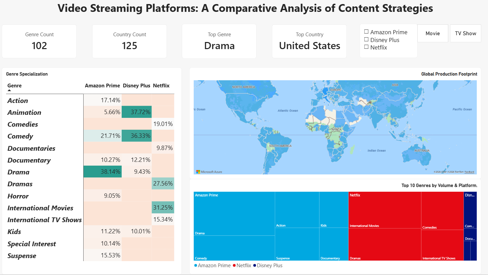
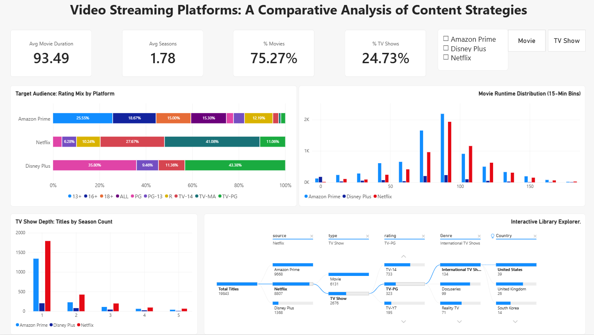

# Video Streaming Platforms: A Comparative Analysis of Content Strategies

An interactive Business Intelligence project developed using **Microsoft
Power BI** to compare content strategies across video streaming
platforms. The dashboard is intended to explore content distribution,
genres, ratings, release trends and geographical patterns using
interactive visualizations.

> **Project note:** Update the dataset source, platform names, record
> count, report-page names and findings below to match the actual
> dataset and dashboard. Do not publish unverified metrics or
> conclusions.

## Table of Contents

-   [Project Overview](#project-overview)
-   [Business Problem](#business-problem)
-   [Objectives](#objectives)
-   [Dataset](#dataset)
-   [Tools and Technologies](#tools-and-technologies)
-   [Methodology](#methodology)
-   [Analysis Areas](#analysis-areas)
-   [Dashboard Screenshots](#dashboard-screenshots)
-   [Business Insights](#business-insights)
-   [Repository Structure](#repository-structure)
-   [How to Open the Project](#how-to-open-the-project)
-   [Conclusion](#conclusion)
-   [Future Enhancements](#future-enhancements)
-   [Author](#author)

------------------------------------------------------------------------

## Project Overview

The project presents a comparative analysis of video streaming platforms
through a Power BI dashboard. It brings content-related information into
an interactive reporting experience so users can explore differences in
platform catalogues and content strategies.

The analysis focuses on multiple dimensions of streaming content, such
as content type, genre, ratings, release year and country, depending on
the fields available in the source dataset.

## Business Problem

Streaming services compete through their content libraries, genre mix,
regional availability and the types of movies and television shows they
offer. Raw datasets can make it difficult to compare these
characteristics across platforms.

This project uses data preparation and interactive business intelligence
reporting to make those comparisons easier to explore and interpret.

## Objectives

-   Compare content distribution across streaming platforms.
-   Examine the mix of movies and TV shows.
-   Explore genre composition and diversity.
-   Analyse content ratings and classifications.
-   Review release-year trends.
-   Explore country-wise or regional content distribution where
    supported by the dataset.
-   Present findings through an interactive Power BI report.

## Dataset

The source files used by the Power BI project are stored in the `Data/`
directory.

  Dataset detail      Project information
  ------------------- ------------------------------------------
  Dataset source      **Add the original source and URL**
  File format         **Add actual format (CSV, Excel, etc.)**
  Platforms covered   **Add actual platform names**
  Number of records   **Add verified record count**
  Main fields         **Add the actual column names**

The analysis should only describe fields and platforms that are present
in the supplied dataset.

## Tools and Technologies

  -----------------------------------------------------------------------
  Tool / Technology                   Purpose
  ----------------------------------- -----------------------------------
  Microsoft Power BI Desktop          Report and dashboard development

  Power Query                         Data connection, cleaning and
                                      transformation, where implemented

  DAX                                 Measures and calculations, where
                                      implemented

  Power BI data model                 Organising tables and
                                      relationships, where implemented

  Git and GitHub                      Source control and project
                                      documentation
  -----------------------------------------------------------------------

## Methodology

1.  **Data inspection:** Review the available source files and
    understand their structure.
2.  **Data preparation:** Connect Power BI to the source data.
3.  **Data cleaning:** Address missing, inconsistent or incorrectly
    formatted values where required.
4.  **Data transformation:** Prepare fields and tables for analysis
    using Power Query, where implemented.
5.  **Data modelling:** Define relationships between tables where
    required.
6.  **Measure development:** Create DAX calculations for report metrics
    where applicable.
7.  **Visualization:** Build report pages, charts, filters and other
    interactive elements.
8.  **Analysis:** Use the report to compare platform content patterns
    and identify evidence-based observations.

## Analysis Areas

The following are the intended analytical themes. Retain only the areas
represented in the actual report.

### 1. Platform-wise content comparison

Compare the volume and composition of content available across
platforms.

### 2. Movies and TV shows

Explore the distribution of movies and television shows by platform or
other available dimensions.

### 3. Genre analysis

Compare genre representation and identify categories with larger or
smaller shares of the available catalogue.

### 4. Ratings and content classification

Review content-rating distributions and classifications included in the
dataset.

### 5. Release trends

Explore how content is distributed across release years and identify
changes over time.

### 6. Geographical distribution

Compare country-wise or regional content availability when geographic
fields are available and reliable.

## Dashboard Screenshots

Screenshots let visitors preview the report without downloading or
opening the Power BI file. Upload your **actual report screenshots**
into the `Screenshots/` folder and use the matching filenames below.
Remove any section that does not correspond to a page or visual in your
report.

### Dashboard overview


### Genra and geography



## Content Profile



-   **Platform comparison:** Add a verified finding about differences in
    content volume or composition.
-   **Content type:** Add a verified observation about the movie and
    TV-show mix.
-   **Genre mix:** Add a verified finding about leading or
    underrepresented genres.
-   **Release trends:** Add a verified observation about content across
    release years.
-   **Geography or ratings:** Add a verified finding if these dimensions
    are included in the report.

Avoid inserting illustrative or assumed results as actual findings.

## Repository Structure

The folder and file names below are illustrative. Keep the structure
section aligned with the actual names in your GitHub repository.

``` text
mutlti-video-streaming-platforms-analytics-powerbi/
│
├── Data/
│   └── source data files
│
├── Screenshots/
│   ├── dashboard-overview.png
│   ├── platform-analysis.png
│   ├── genre-analysis.png
│   ├── ratings-release-trends.png
│   └── geographical-analysis.png
│
├── Movie and Tv show Analysis.Report/
├── Movie and Tv show Analysis.SemanticModel/
├── Movie and Tv show Analysis.pbip
├── Movie and Tv show Analysis.pbix
├── .gitignore
└── README.md
```

## How to Open the Project

### Requirements

-   Microsoft Power BI Desktop.
-   Access to the project source data.
-   Git, if you want to clone the repository.

### Clone the repository

``` bash
git clone https://github.com/kaushik-path/mutlti-video-streaming-platforms-analytics-powerbi.git
cd mutlti-video-streaming-platforms-analytics-powerbi
```

### Open in Power BI Desktop

1.  Open the cloned project folder.
2.  Locate the `.pbip` file and open it with Power BI Desktop.
    Alternatively, open the `.pbix` file.
3.  If Power BI reports a missing source, open **Home → Transform
    data**.
4.  In Power Query, update the source paths to point to the local files
    in the `Data/` directory.
5.  Confirm that all required source files are present.
6.  Select **Close & Apply**, then refresh the report.
7.  Review the report pages and interact with the available filters and
    visuals.

**Important:** Local folder paths may differ between computers. Do not
assume that a path from the original development machine will work for
another user. A Power Query parameter for the project data-folder path
can make this easier to maintain.

## Conclusion

This project demonstrates the use of Power BI for comparative content
analysis and business intelligence reporting. It brings together data
preparation, modelling and visualization in an interactive report that
helps users explore content strategies across streaming platforms.

The value of the project is in the analysis supported by the dataset and
the clarity with which the dashboard communicates its findings.

## Future Enhancements

-   Add more streaming platforms or updated datasets.
-   Include audience, viewership or engagement data if reliable sources
    are available.
-   Extend the analysis with additional DAX measures.
-   Improve data refresh and source-path management.
-   Add a documented data dictionary and metric definitions.
-   Expand the report with additional business questions and validated
    insights.

## Author

**Kaushik Pathak**

Data Analytics \| Business Intelligence \| Power BI \| SQL \| Python

-   GitHub: [kaushik-path](https://github.com/kaushik-path)
-   LinkedIn: **Add your LinkedIn profile URL**

------------------------------------------------------------------------

If you find this project useful, feel free to explore the repository and
share constructive feedback.
