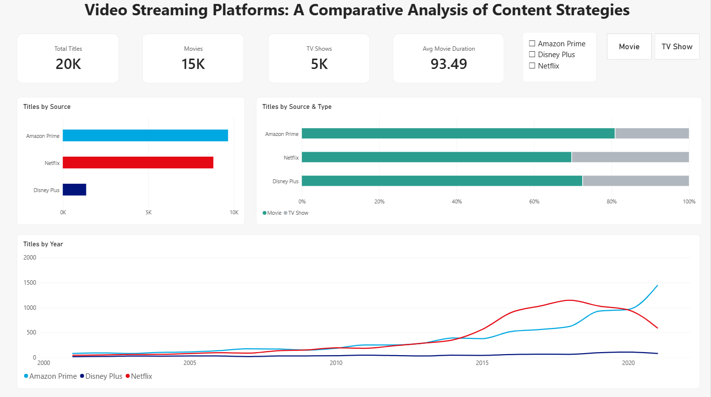

<div align="center">

# Video Streaming Platforms: A Comparative Analysis of Content Strategies

**Netflix vs Amazon Prime vs Disney+: what each platform puts on the shelf, and who it is built for.**


</div>



## Table of Contents

- [Project Overview](#-project-overview)
- [Business Problem](#-business-problem)
- [Objectives](#-objectives)
- [Dataset](#-dataset)
- [Tools and Technologies](#-tools-and-technologies)
- [Key Questions the Dashboard Answers](#-key-questions-the-dashboard-answers)
- [Tools and Technologies](#-tools-and-technologies)
- [Tools and Technologies](#-tools-and-technologies)
- [Methodology](#-methodology)
- [Analysis Areas](#-analysis-areas)
- [Dashboard Screenshots](#-dashboard-screenshots)
- [Business Insights](#-business-insights)
- [Repository Structure](#-repository-structure)
- [How to Open the Project](#-how-to-open-the-project)
- [Conclusion](#-conclusion)
- [Future Enhancements](#-future-enhancements)
- [Author](#-author)

---

## Project Overview

An interactive Power BI dashboard that compares the content libraries of **Netflix, Amazon Prime and Disney+**. It combines three raw catalogue exports into one model and lets users explore catalogue size, movie vs TV mix, genres, audience ratings, runtimes, release trends and production countries.

| | |
|---|---|
| **Platforms** | Netflix, Amazon Prime, Disney+ |
| **Titles analysed** | 19,843 (15K movies, 5K TV shows) |
| **Genres / countries** | 102 genres, 125 countries |
| **Dashboard** | 3 interactive pages: Overview, Content Profile, Genre & Geography |
| **Stack** | Power BI, Power Query (M), DAX, data model with bridge tables |

---

## Business Problem

A streaming platform wins subscribers through its library. A content or strategy team keeps asking the same questions, but raw catalogue files can't answer them quickly:

- How big is each library, and how is it split between movies and TV shows?
- Is a platform still growing its catalogue, or slowing down?
- Which genres does each platform lean on, and where is it thin?
- Is the content built for kids and families or for mature audiences?
- Where does the content come from?

This project turns three separate files into one interactive view where those questions can be answered in a few clicks.

---

## Objectives

- Compare catalogue size and share across platforms.
- Measure the movie vs TV show mix of each platform.
- Identify each platform's genre strengths and gaps.
- Compare target audiences through content ratings.
- Track how catalogue volume changes by release year.
- Understand production geography and where content comes from.
- Deliver all of this as a clean, filterable Power BI report for non-technical users.

---

## Dataset

Three CSV files in the `Data/` folder, all with the same 12 columns:
`show_id, type, title, director, cast, country, date_added, release_year, rating, duration, listed_in, description`

| File | Platform | Rows | Movies | TV Shows |
|---|---|---|---|---|
| `netflix_titles.csv` | Netflix | 8,807 | 6,131 | 2,676 |
| `amazon_prime_titles.csv` | Amazon Prime | 9,668 | 7,814 | 1,854 |
| `disney_plus_titles.csv` | Disney+ | 1,368 | 991 | 377 |
| **Total** | | **19,843** | **14,936** | **4,907** |

Release years in the data run from the 1920s to 2021.


### Data notes and limitations

- **Missing countries are filled with "United States".** About 93% of Amazon Prime's rows (8,996 of 9,668) have no country in the source, so the US count and the **Top Country** card are likely overstated.
- **Genre labels differ by platform.** The same genre appears as *Comedy* (Amazon, Disney+) and *Comedies* (Netflix), *Drama* and *Dramas*, *Documentary* and *Documentaries*. The genre matrix shows these as separate rows.
- **Genre percentages are shares of genre tags,** not of titles, because one title can carry several genres.
- **Snapshot data.** Files end in 2021, so the latest release year may be incomplete. The data covers catalogue content, not viewership.
- **Rating systems differ.** Amazon uses age bands (13+, 16+, ALL) while Netflix and Disney+ use TV/MPA ratings, so cross-platform rating comparisons are directional.
- `date_added` is ~98% empty for Amazon, so it was dropped from the analysis.

---

## Tools and Technologies

| Tool | Used for |
|---|---|
| **Power BI Desktop** | Report and dashboard design |
| **Power Query (M)** | Loading, cleaning and reshaping the data |
| **DAX** | KPI and analytical measures |
| **Data modelling** | Bridge tables and relationships for multi-value fields |
| **PBIP project format** | Version-control-friendly report and model files |
| **Git & GitHub** | Source control and documentation |

## Key Questions the Dashboard Answers

| Business question | Where to look | Metric used |
|---|---|---|
| Who has the biggest library? | Overview | Total Titles, Platform Share |
| Movie-heavy or series-heavy? | Overview, Content Profile | % Movies, % TV Shows |
| Is the catalogue growing? | Overview | Titles by release year |
| What is each platform's genre identity? | Genre & Geography | Genre specialization matrix, treemap |
| Which audience does it target? | Content Profile | Rating mix by platform |
| How long are movies, and how deep are series? | Content Profile | Avg Movie Duration, Avg Seasons, runtime bins |
| Where is content produced? | Genre & Geography | Country Count, Top Country, map |

---

## Key Findings

> All numbers below come from the dataset and the dashboard screenshots.

**1. Amazon Prime has the largest catalogue, Netflix is close, Disney+ is small.**
Amazon Prime has 9,668 titles, Netflix 8,807 and Disney+ 1,368. Disney+ is roughly 14% the size of Amazon, so it competes on curation rather than volume.

**2. Everyone is movie-first, Amazon most of all.**
Movies make up 75.27% of all titles. By platform: Amazon Prime ~81%, Disney+ ~72%, Netflix ~70%. Netflix has the most balanced mix, which fits its heavy investment in series.

**3. Netflix's release-year volume peaks around 2018 and then drops; Amazon keeps climbing.**
Netflix overtakes Amazon in titles per release year from about 2015, peaks near 2018, and falls by 2021. Amazon accelerates to its highest point in 2021. *Note: the data is a 2021 snapshot, so the latest year may be incomplete.*

**4. Each platform has a clear genre identity.**
- **Amazon Prime:** Drama-led (38.14% of its genre tags), then Comedy, Action and Suspense.
- **Netflix:** International Movies (31.25%) and Dramas (27.56%) lead, backed by International TV Shows.
- **Disney+:** Animation (37.72%) and Comedy (36.33%), with Kids and Family strongly represented.

**5. The audiences are different.**
Netflix leans toward mature ratings (TV-MA is its most common rating, followed by TV-14). Disney+ is built around TV-G, TV-PG, G and PG. Amazon's most common ratings are 13+, 16+ and ALL, with a notable 18+ share.

**6. Movies cluster around 90 minutes; most series are short-run.**
Average movie duration is 93.49 minutes and the runtime histogram peaks in the 90–105 minute bins on all three platforms. TV shows average 1.78 seasons, and the largest group on every platform is single-season shows.

**7. Content is global, with the US and India most visible.**
Drama is the top genre overall and the United States the top country. In the raw files, India is the second-largest producing country for both Netflix and Amazon Prime. Read the US figure with the caution below.

### What this suggests for a content team

- **Disney+** can't win on volume, so its edge is the family and animation niche. Adding library breadth outside it is the open question.
- **Netflix** has pulled back on new-title volume since its 2018 peak while staying international-heavy. Its mix points to a quality-over-quantity shift, which is worth testing against viewership data.
- **Amazon** is the volume play, strongest in Drama and broad in ratings, so it is aiming at the widest audience.

*These are readings of catalogue data only. Viewership or engagement data would be needed to confirm them.*

**Key DAX measures**

| Measure | Purpose |
|---|---|
| `Total Titles` | Distinct count of title keys |
| `Movies`, `TV Shows` | Titles filtered by type |
| `% Movies`, `% TV Shows` | Share of the catalogue |
| `Platform Share` | Platform titles as a share of all titles |
| `Avg Movie Duration` | Mean runtime in minutes (movies only) |
| `Avg Seasons` | Mean season count (TV shows only) |
| `Genre Count`, `Country Count` | Distinct genres and countries in the current filter |
| `Top Genre`, `Top Country`, `Top Rating` | `TOPN`-based leaders for the current filter |
| `Genre % of Platform` | A genre's share of all genre tags in the current filter |
| `duration_in_min (bins)` | 15-minute runtime buckets |

---

## Methodology

1. **Combine:** loaded all CSVs from the `Data/` folder in one Power Query and tagged each row with its platform from the file name.
2. **Clean:** promoted headers, set data types, removed rows with type errors, and filled blank `director`/`cast` with `n/A` and blank `rating` with `Rating Not Available`.
3. **Transform:** split `duration` into `duration_in_min` (movies) and `tv_shows_season` (TV shows), and dropped `description` and `date_added`.
4. **Create a unique key:** built `Key = source_show_id`, since `show_id` repeats across platforms.
5. **Handle multi-value fields:** split comma-separated `listed_in` and `country` into one row per value, trimmed them, and stored them as two bridge tables, **Genre-Map** and **Country-Map**.
6. **Model:** joined both bridge tables to the main `Data` table on `Key`, so a title with several genres or countries counts in each one.

```
Genre-Map ──┐
            ├──►  Data  (one row per title)
Country-Map ┘
```

7. **Measure:** wrote DAX for KPIs, shares, averages and "top" cards.
8. **Visualise:** built three report pages with platform and content-type slicers on every page.

---

## 📊 Analysis Areas

| # | Area | What it shows | Where |
|---|---|---|---|
| 1 | **Platform comparison** | Catalogue size and share by platform | Overview |
| 2 | **Movies vs TV shows** | Content-type mix per platform | Overview, Content Profile |
| 3 | **Release trends** | Titles per release year by platform | Overview |
| 4 | **Genre analysis** | Genre specialization and top-10 genres | Genre & Geography |
| 5 | **Ratings & audience** | Rating mix, movie runtime, TV season depth | Content Profile |
| 6 | **Geography** | Production footprint across 125 countries | Genre & Geography |

---

## Dashboard Screenshots

### Page 1: Overview
Platform size, movie vs TV split and release-year trend, with slicers for platform and content type.


### Page 2: Genre and Geography
Genre specialization by platform, a global production map and a top-10 genres treemap.


### Page 3: Content Profile
Rating mix by platform, movie runtime distribution in 15-minute bins, TV season depth and an interactive library explorer (source → type → rating → genre → country).


---

## Business Insights

**1. Amazon Prime has the biggest library, Netflix is close, Disney+ is small.**
Amazon has 9,668 titles, Netflix 8,807 and Disney+ 1,368. Disney+ is about 14% of Amazon's size, so it competes on curation rather than volume.

**2. Every platform is movie-first, Amazon most of all.**
Movies are 75.27% of all titles: Amazon ~81%, Disney+ ~72%, Netflix ~70%. Netflix has the most balanced mix, in line with its heavy series investment.

**3. Netflix's release-year volume peaks around 2018 and then falls; Amazon keeps climbing.**
Netflix leads in titles per release year from about 2015 and peaks near 2018, then drops by 2021. Amazon accelerates to its highest point in 2021. *The data is a 2021 snapshot, so the last year may be incomplete.*

**4. Each platform has a clear genre identity.**
- **Amazon Prime:** Drama-led (38.14% of its genre tags), then Comedy, Action and Suspense.
- **Netflix:** International Movies (31.25%) and Dramas (27.56%), backed by International TV Shows.
- **Disney+:** Animation (37.72%) and Comedy (36.33%), with Kids and Family strongly represented.

**5. The audiences are different.**
Netflix leans mature (TV-MA is its most common rating, then TV-14). Disney+ is built around TV-G, TV-PG, G and PG. Amazon's most common ratings are 13+, 16+ and ALL, with a notable 18+ share.

**6. Movies cluster around 90 minutes; most series are short-run.**
Average movie duration is 93.49 minutes, and the runtime histogram peaks in the 90–105 minute bins on all three platforms. TV shows average 1.78 seasons, and single-season shows are the largest group on every platform.

**7. Content is global, with the US and India most visible.**
Drama is the top genre overall and the United States the top country. In the raw files, India is second for both Netflix and Amazon Prime. Treat the US figure with caution (see data notes).

### What this suggests for a content team

- **Disney+** can't win on volume, so its edge is the family and animation niche. The open question is how far it should broaden beyond it.
- **Netflix** has cut new-title volume since its 2018 peak while staying international-heavy. That points to a quality-over-quantity shift, worth testing against viewership data.
- **Amazon** is the volume play: strong in Drama and broad across ratings, aimed at the widest audience.

*These readings come from catalogue data only. Viewership or engagement data would be needed to confirm them.*

---

## Repository Structure

```text
mutlti-video-streaming-platforms-analytics-powerbi/
│
├── Data/
│   ├── netflix_titles.csv
│   ├── amazon_prime_titles.csv
│   └── disney_plus_titles.csv
│
├── Screenshots/
│   ├── 1.png                                  # Overview
│   ├── 2.png                                  # Genre and geography
│   └── 3.png                                  # Content profile
│
├── Movie and Tv show Analysis.Report/         # PBIP report definition
├── Movie and Tv show Analysis.SemanticModel/  # PBIP model (tables, DAX, relationships)
├── Movie and Tv show Analysis.pbip
├── Movie and Tv show Analysis.pbix
├── .gitignore
└── README.md
```

---

## How to Open the Project

**Requirements:** Power BI Desktop (Windows).

```bash
git clone https://github.com/kaushik-path/mutlti-video-streaming-platforms-analytics-powerbi.git
```

1. Open `Movie and Tv show Analysis.pbix` (or the `.pbip` file) in Power BI Desktop.
2. If Power BI shows a missing-source error, go to **Home → Transform data → Data → Source**.
3. The `Data` query points to a local folder on the original machine. Change the path in `Folder.Files(...)` to your cloned `Data/` folder.
4. Click **Close & Apply** and refresh.

> Platform names come from the file names (`netflix`, `amazon`, `disney`), so keep the three CSV names unchanged.

---

## Conclusion

The three platforms are building very different libraries. Amazon competes on volume and breadth, Netflix on an international, mature-leaning mix, and Disney+ on a smaller, family-and-animation catalogue. The project shows an end-to-end BI workflow: combining raw files, cleaning and modelling multi-value fields, writing DAX and presenting the results in a dashboard a business user can explore on their own.

---

## Future Enhancements

- Standardize genre labels across platforms (Comedy/Comedies, Drama/Dramas) for a like-for-like comparison.
- Replace the "United States" default with an *Unknown* category to make country analysis reliable.
- Add a data-folder parameter in Power Query so the project opens on any machine without edits.
- Add viewership, IMDb score or subscriber data to link catalogue strategy to performance.
- Add more platforms and a newer snapshot to track change over time.
- Add a short data dictionary and metric definitions.

---

## Author

**Kaushik Pathak**
Data Analytics | Business Intelligence | Power BI | SQL | Python

[](https://github.com/kaushik-path)

⭐ If this project was useful, a star on the repo is appreciated.